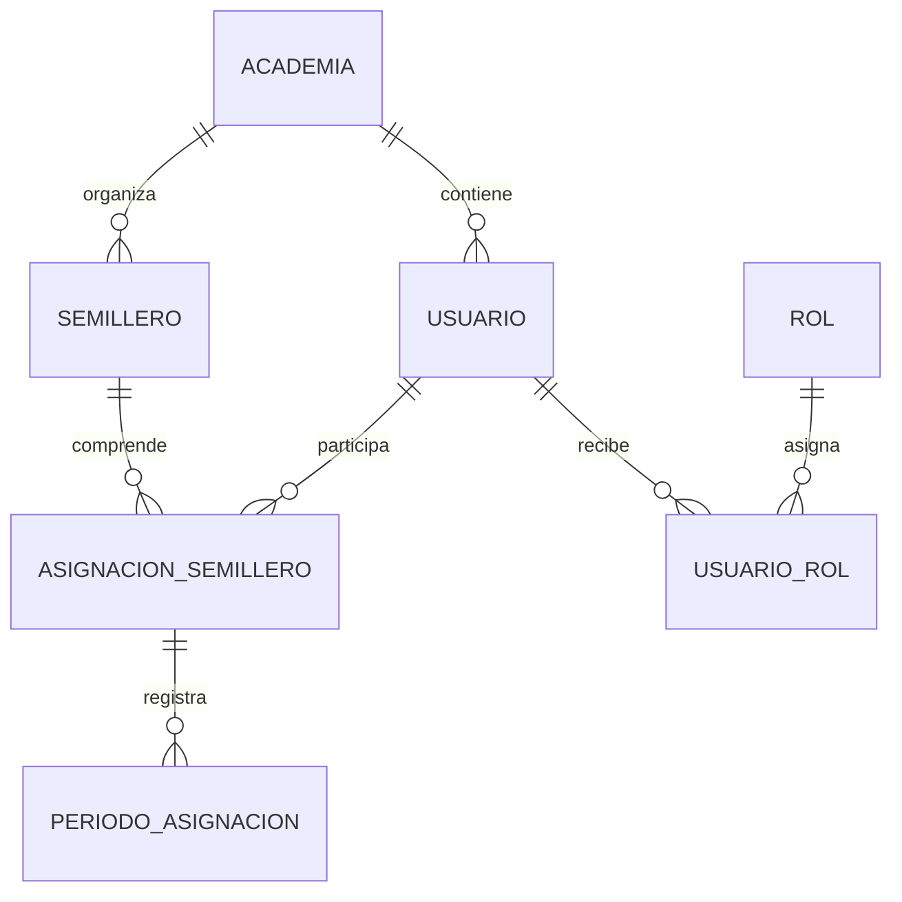
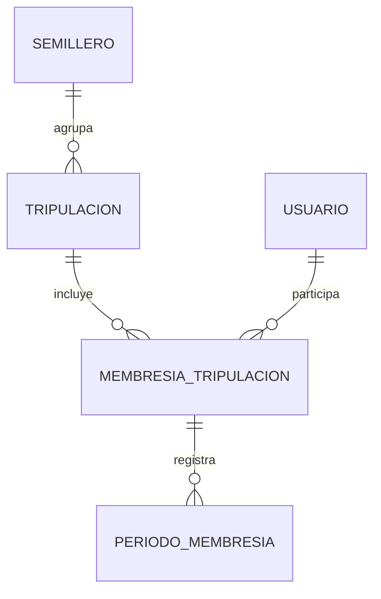
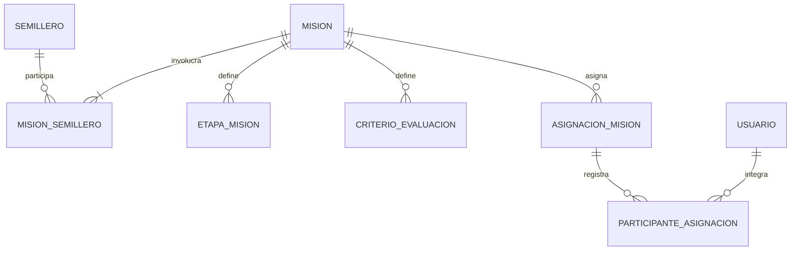
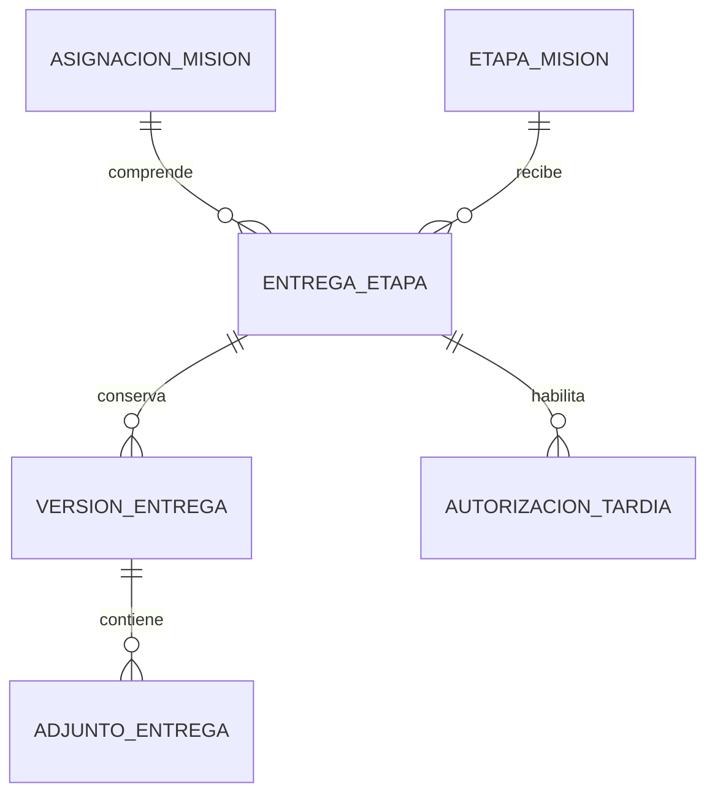
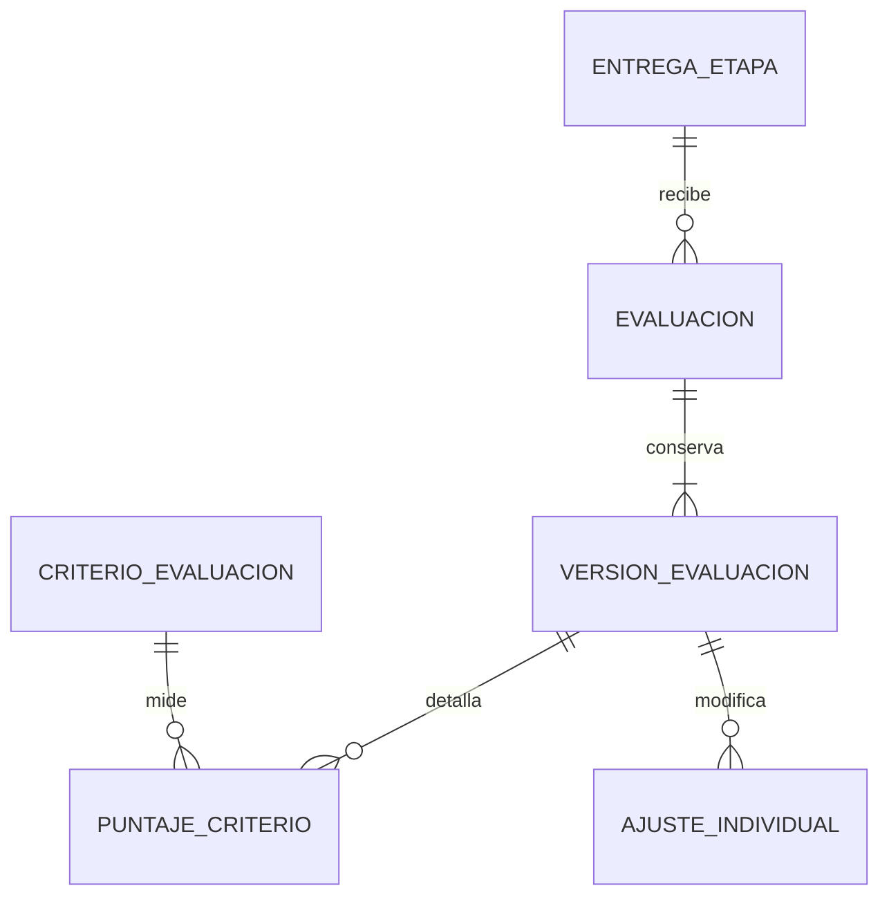

# Modelo de datos de Laboratorio — propuesta integral para revisión

Estado: **referencia de diseño; esquema inicial implementado en V2**. Fecha: 9 de noviembre de 2026. Consultar `DATA-MODEL-STATUS.md` para las limitaciones reales y reglas no implementadas.

Este documento transforma las reglas conocidas en un diseño conceptual y lógico. Las decisiones marcadas como propuestas necesitan aprobación antes de crear migraciones académicas. El alcance incluye MVP y extensiones futuras; no implica implementar chat ni simuladores ahora. Las tablas técnicas existentes de Flyway y `app_metadata` permanecen fuera del dominio.

## Convenciones

- Cada entidad persistente tiene `id` (UUID, propuesta). Referencias terminan en `_id`; `creado_en` y demás instantes se almacenan en UTC. Los intervalos usan inicio inclusivo y fin exclusivo.
- `!` indica obligatorio; `?`, opcional. Las claves y restricciones se expresan conceptualmente, no como SQL definitivo. Los identificadores de catálogos son estables; los nombres son editables.
- Evitar borrado físico de historial académico. Desactivar o cerrar vigencia; las correcciones históricas se registran como nuevos eventos o versiones. Auditoría no sustituye al historial de negocio.
- Una misma academia debe coincidir en todos los extremos relacionados. Las reglas de acceso se comprueban en servidor por usuario, rol, asignación y recurso, independientemente de las claves foráneas.
- PostgreSQL es el destino productivo; H2 se usa para desarrollo y pruebas. Las restricciones particulares de un motor se verificarán en ambos y las que requieran concurrencia se validarán también en PostgreSQL.

## 1. Academia, identidad y semilleros

| Entidad | Atributos, además de `id` | Reglas |
|---|---|---|
| Academia | nombre!, estado!, creado_en! | Unidad administrativa. |
| Usuario | academia_id!, correo!, nombre!, apellido!, password_hash!, estado!, creado_en! | Correo único global tras normalización definida; hash BCrypt, nunca contraseña en texto. La pertenencia a una academia sigue el modelo preliminar actual. |
| Rol | codigo!, nombre! | Código único; roles iniciales ADMINISTRADOR, PROFESOR y ESTUDIANTE. |
| UsuarioRol | usuario_id!, rol_id!, asignado_en! | Único `(usuario_id, rol_id)`; varios roles simultáneos. El historial de cambios se conserva en auditoría. |
| Semillero | academia_id!, codigo!, nombre!, descripcion?, estado! | Único `(academia_id, codigo_normalizado)`. Inicialmente Robótica y Astronomía y Física Espacial, sin codificar esas opciones en lógica. |
| AsignacionSemillero | usuario_id!, semillero_id!, creado_en! | Una relación por pareja `(usuario_id, semillero_id)`, reutilizada al reactivar. Usuario y semillero pertenecen a la misma academia. |
| PeriodoAsignacion | asignacion_id!, inicio!, fin?, registrado_por_id! | Intervalos no solapados; como máximo uno abierto por asignación. Conservar altas, bajas y reactivaciones. El estado activo se deriva de los períodos. |

**Alternativa de historial:** una fila de asignación por período con unicidad de períodos activos. Se recomienda relación estable más períodos porque permite reactivar sin perder identidad ni historial. La implementación de exclusión de intervalos y concurrencia debe probarse específicamente; una comprobación previa sin bloqueo no garantiza unicidad.

## 2. Tripulaciones

| Entidad | Atributos | Reglas |
|---|---|---|
| Tripulacion | semillero_id!, nombre!, descripcion?, estado!, creado_en! | Pertenece a un semillero; nombre único por semillero según normalización propuesta. |
| MembresiaTripulacion | tripulacion_id!, usuario_id! | Única por pareja; usuario y tripulación de la misma academia. |
| PeriodoMembresia | membresia_id!, inicio!, fin?, funcion!, registrado_por_id! | Función PARTICIPANTE o RESPONSABLE propuesta; períodos no solapados, uno abierto como máximo. Al asignar se comprueba pertenencia vigente al semillero. |

Propuesta pendiente: decidir si toda Tripulación debe tener al menos un responsable activo y qué sucede al cerrar la asignación de un miembro a su semillero. Las Misiones interdisciplinarias pueden involucrar varias Tripulaciones sin que una Tripulación pertenezca a múltiples semilleros.

## 3. Misiones y asignaciones

| Entidad | Atributos | Reglas |
|---|---|---|
| Mision | academia_id!, titulo!, instrucciones!, modalidad!, estado!, creada_por_id!, inicio?, vencimiento?, politica_evaluacion!, creado_en! | Modalidad INDIVIDUAL, GRUPAL o INTERDISCIPLINARIA; inicio ≤ vencimiento cuando ambos existen. Solo docentes autorizados administran Misiones. |
| MisionSemillero | mision_id!, semillero_id! | Pareja única y misma academia; al menos un semillero por Misión publicada. |
| EtapaMision | mision_id!, titulo!, instrucciones?, orden!, obligatoria!, es_final!, vencimiento? | Orden único por Misión; exactamente una etapa final para una Misión publicable. La final es obligatoria (propuesta). |
| CriterioEvaluacion | mision_id!, etapa_id?, nombre!, descripcion!, peso?, orden! | Si existe etapa, pertenece a la Misión. El significado de pesos y su suma requiere política aprobada. |
| AsignacionMision | mision_id!, destinatario_usuario_id?, destinatario_tripulacion_id?, estado!, asignada_en! | Exactamente uno de los dos destinatarios. Individual → usuario; grupal → Tripulación. Para interdisciplinaria se propone permitir cualquiera, pendiente de aprobación. Un destinatario no se duplica en la misma Misión. |
| ParticipanteAsignacion | asignacion_id!, usuario_id!, incorporado_en!, retirado_en? | Pareja única por asignación. Para una Tripulación, registrar participantes efectivos y sus fechas; no depender de su membresía actual para reconstruir entregas antiguas. |

El esquema de dos referencias opcionales con `CHECK` exclusivo permite integridad referencial; se recomienda frente a un campo genérico `tipo + id`, que no tendría claves foráneas verificables. Antes de publicar se validan modalidad, semilleros, destinatarios, etapas y criterios. Cómo evolucionan los participantes después de asignar es una decisión pendiente de negocio.

## 4. Entregas y versiones

| Entidad | Atributos | Reglas |
|---|---|---|
| EntregaEtapa | asignacion_id!, etapa_id!, creado_en! | Única por asignación y etapa; ambos pertenecen a la misma Misión. |
| VersionEntrega | entrega_etapa_id!, numero!, autor_id!, contenido?, enviada_en!, autorizacion_id? | Único `(entrega_etapa_id, numero)`; versiones inmutables. Al menos contenido o adjunto. Autor autorizado como participante o responsable según política. |
| AdjuntoEntrega | version_id!, nombre_original!, clave_almacenamiento!, tipo_mime!, tamano!, hash! | Clave interna, no ruta suministrada por usuario; límites y almacenamiento se definirán antes de implementar archivos. |
| AutorizacionTardia | entrega_etapa_id!, concedida_por_id!, motivo!, concedida_en!, valida_hasta?, revocada_en? | Autor docente autorizado; registra alcance y vigencia. Una versión posterior al límite efectivo requiere autorización válida y referencia a ella. |

La etapa final identifica la entrega final; las etapas admiten varias versiones. Propuesta: la fecha efectiva es la de la etapa si existe; en otro caso la de la Misión. Una entrega sin fecha límite no es tardía. Los cambios de criterios, plazos y participantes después de publicar requieren una política de versionado antes de habilitarse.

## 5. Evaluaciones y calificaciones

| Entidad | Atributos | Reglas |
|---|---|---|
| Evaluacion | entrega_etapa_id! | Una evaluación lógica por entrega de etapa; el modo de evaluación de la Misión determina cuáles etapas pueden evaluarse. |
| VersionEvaluacion | evaluacion_id!, numero!, version_entrega_id!, evaluador_id!, calificacion_base!, observacion?, registrada_en! | Único por evaluación y número; referencia una versión de la misma entrega. Inmutable; una corrección crea nueva versión. La más reciente es la vigente salvo anulación explícita propuesta. |
| PuntajeCriterio | version_evaluacion_id!, criterio_id!, puntaje!, comentario? | Un criterio por versión; criterio aplicable a Misión/etapa. La escala y fórmula de agregación requieren aprobación. |
| AjusteIndividual | version_evaluacion_id!, usuario_id!, ajuste!, justificacion! | Único por versión y participante. Solo en asignaciones grupales; ajuste justificado y usuario perteneciente a la asignación. La nota final se deriva de base + ajuste bajo límites aprobados. |

Una Misión individual produce calificación individual; una grupal tiene base grupal y ajustes individuales justificados. Una Misión puede evaluar etapas o solo final según su configuración. **Pendiente:** escala, redondeo, límites, visibilidad, publicación y tratamiento de cambios posteriores; no se fija una fórmula sin decisión académica. En interdisciplinarias deben aprobarse las reglas de evaluación según destinatario.

## 6. Competencias y progreso

| Entidad | Atributos | Reglas |
|---|---|---|
| Competencia | academia_id!, codigo!, nombre!, descripcion?, estado! | Código único por academia. |
| CompetenciaSemillero | competencia_id!, semillero_id! | Pareja única, misma academia. |
| CriterioCompetencia | criterio_id!, competencia_id!, contribucion? | Pareja única, misma academia; contribución y fórmula pendientes. |
| AlertaRendimiento | usuario_id!, competencia_id?, semillero_id?, tipo!, estado!, generada_en!, resuelta_en?, detalle! | Alertas derivadas con evidencia y fecha; el acceso se restringe a personas autorizadas. |

Promedios, progreso y competencias débiles se calculan desde evaluaciones vigentes y sus criterios. Las agregaciones o instantáneas de rendimiento son optimizaciones posteriores, reconstruibles desde los registros originales. Deben definirse períodos, ponderaciones, umbrales y reglas para notas faltantes antes de automatizar resultados.

## 7. Gamificación

| Entidad | Atributos | Reglas |
|---|---|---|
| MovimientoXP | usuario_id!, semillero_id?, cantidad!, motivo!, origen_tipo!, origen_id!, creado_en! | Libro de movimientos inmutable; clave de idempotencia única por evento. Correcciones mediante compensación, sin borrar historial. Origen y pertenencia deben verificarse. |
| Rango | codigo!, nombre!, umbral_xp!, estado! | Código único; umbrales y reglas de evolución requieren aprobación. |
| Insignia | codigo!, nombre!, descripcion!, estado! | Código único. |
| InsigniaUsuario | insignia_id!, usuario_id!, concedida_en!, motivo! | Pareja única si la insignia solo puede concederse una vez; pendiente decidir revocación y recurrencia. |

Clasificaciones por semillero y global se calculan con una fórmula que considere desempeño académico además de actividad; **la fórmula no está aprobada**. Evitar sumar dos veces eventos interdisciplinarios: la distribución o atribución entre semilleros requiere una decisión explícita. El total global no debe asumirse como suma de rankings por semillero sin esa regla.

## 8. Extensiones posteriores

| Entidad | Atributos principales | Condiciones |
|---|---|---|
| Notificacion | destinatario_id!, tipo!, contenido!, creada_en!, leida_en? | Acceso exclusivo al destinatario o personal autorizado. |
| Auditoria | actor_id?, accion!, recurso_tipo!, recurso_id!, ocurrido_en!, resultado!, correlacion_id?, detalles? | Sin secretos ni contraseñas; alcance, retención y acceso por definir. |
| Conversacion | academia_id!, tipo!, creada_en! | Para chat posterior; reglas de acceso y retención pendientes. |
| ParticipanteConversacion | conversacion_id!, usuario_id!, unido_en!, salido_en? | Pareja e historial sujetos a política posterior. |
| Mensaje | conversacion_id!, autor_id!, contenido!, enviado_en!, editado_en?, eliminado_en? | Autorización por conversación; tratamiento de ediciones y moderación por definir. |

PDF y simuladores no necesitan tablas propias hasta precisar sus requisitos. Adjuntos y chat requieren definir almacenamiento, cuotas, retención y privacidad.

## 9. Integridad, transacciones y rendimiento

1. Claves primarias y foráneas explícitas, columnas obligatorias y restricciones `CHECK` para estados, fechas y destinatarios exclusivos. Aplicar claves compuestas o validaciones transaccionales para las relaciones que deben pertenecer a la misma academia y Misión.
2. Índices únicos para correos normalizados, códigos por academia, relaciones y números de versión. Índices de consulta para semilleros activos de un usuario, miembros activos, Misiones por destinatario/estado/fecha, versiones por entrega y evaluaciones vigentes. Confirmar planes sobre datos reales antes de añadir índices redundantes.
3. Reactivaciones, altas concurrentes y asignación de número de versión se ejecutan en transacciones; la base de datos y/o bloqueos apropiados deben impedir carreras. `@Version` optimista puede complementar, pero no sustituye restricciones.
4. Evaluaciones, versiones y movimientos XP se escriben de manera transaccional. Los cálculos de promedios deben considerar únicamente versiones vigentes y respetar autorización.
5. Paginar listados, proyectar datos necesarios y evitar N+1. No cargar colecciones completas para calcular agregados. Validar accesos individuales a entregas y calificaciones también en consultas.
6. Las pruebas deben cubrir unicidad bajo concurrencia, períodos y reactivaciones, aislamiento por academia, destinatarios exclusivos, entregas tardías, historial y ajustes; probar migraciones y comportamiento tanto en H2 como en PostgreSQL cuando esté disponible.

## 10. Decisiones que requieren aprobación

- **D1:** identidad de asignación estable más períodos, frente a una fila por período; y reglas al cerrar una membresía de semillero.
- **D2:** Tripulación con un semillero, obligatoriedad de responsable y evolución de participantes en Misiones asignadas.
- **D3:** destinatarios permitidos y evaluación en Misiones interdisciplinarias.
- **D4:** etapa final obligatoria; plazos efectivos y alcance de una autorización tardía.
- **D5:** escala, pesos, redondeo, límites, publicación y corrección de calificaciones; cambios de criterios y plazos tras publicación.
- **D6:** fórmula de competencias, promedios y alertas; períodos y notas faltantes.
- **D7:** concesión y corrección de XP e insignias, fórmula de clasificación y atribución interdisciplinaria.
- **D8:** criterios de almacenamiento, retención y autorización para adjuntos, auditoría, notificaciones y chat.
- **D9:** alcance de academia por usuario, normalización de correo, y compatibilidad concreta de restricciones H2/PostgreSQL.

La migración V2 implementa una primera estructura de las entidades anteriores por petición expresa. Las decisiones y reglas aún abiertas se detallan en `DATA-MODEL-STATUS.md`; la existencia de tablas no demuestra que esas reglas estén implementadas.
